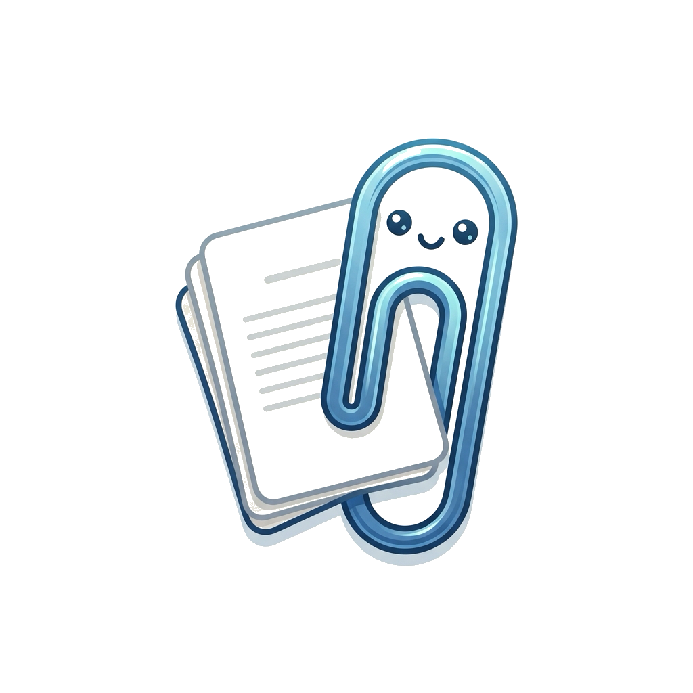
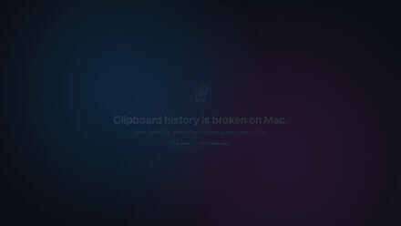
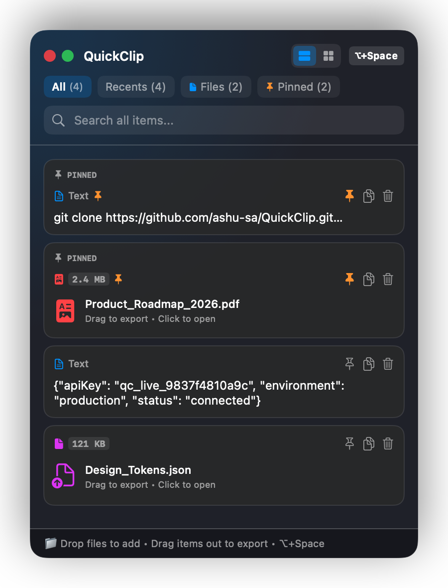
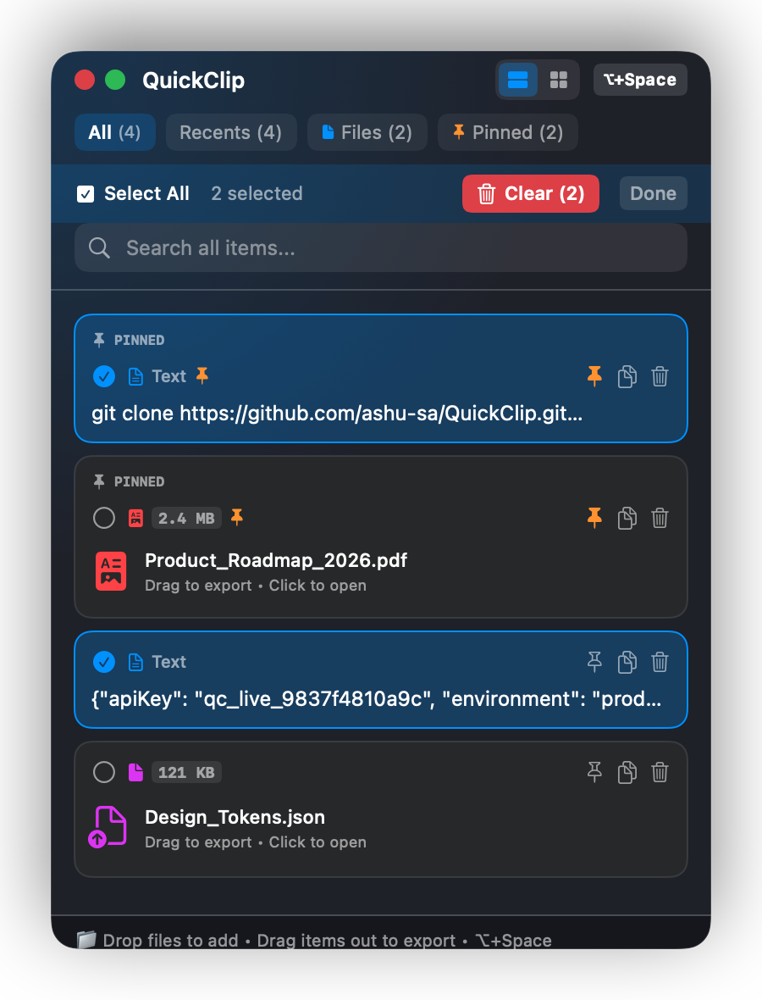

<div align="center">
  
  <h1>QuickClip</h1>
  <p><strong>A lightning-fast, floating clipboard HUD & lightweight document stash for macOS.</strong></p>

  <p>
    <a href="https://github.com/ashu-sa/QuickClip/releases"></a>
    
    
    
    
  </p>

  <p>
    <a href="#-preview">Preview</a> •
    <a href="#-core-features">Features</a> •
    <a href="#-installation">Installation</a> •
    <a href="#-shortcuts--gestures">Shortcuts</a> •
    <a href="#-privacy--architecture">Privacy</a> •
    <a href="#-contributing">Contributing</a>
  </p>
</div>

---

## 🎬 Preview

<div align="center">
  
  <p><em>Summon with <kbd>⌥ Option</kbd> + <kbd>Space</kbd> • Instant search • Drag & drop clips outward • Lightweight file stash</em></p>
</div>

---

## ✨ Core Features

<table>
  <tr>
    <td width="50%" valign="top">
      <h3>⚡ Instant HUD Access</h3>
      <p>Summon or dismiss the floating HUD instantly from anywhere via <kbd>⌥ Option</kbd> + <kbd>Space</kbd>. Zero dock presence (<code>LSUIElement</code>) to keep your workspace distraction-free.</p>
    </td>
    <td width="50%" valign="top">
      <h3>📎 Drag & Drop Export</h3>
      <p>Grab any text snippet or image clip and drag it straight into external applications—Slack, Discord, VS Code, Figma, or web forms—with zero friction.</p>
    </td>
  </tr>
  <tr>
    <td width="50%" valign="top">
      <h3>📁 Dedicated Document Stash</h3>
      <p>Drag files or PDFs (up to 5MB) directly into the <strong>Files</strong> tab for quick staging, or browse your local system through the native macOS file picker.</p>
    </td>
    <td width="50%" valign="top">
      <h3>📌 Smart Pinning & Persistence</h3>
      <p>Keep frequently used code boilerplate, tokens, and vital documents pinned at the top. All history, pins, and files automatically persist safely across reboots.</p>
    </td>
  </tr>
  <tr>
    <td width="50%" valign="top">
      <h3>🛡️ Safe Selection & Pruning</h3>
      <p>Click any card to trigger batch selection mode with <strong>Select All</strong> capability and confirmation guards (<em>"Your paste data will be erased. Continue?"</em>) to prevent accidental loss.</p>
    </td>
    <td width="50%" valign="top">
      <h3>🔍 Instant Filter & Tab Layouts</h3>
      <p>Switch seamlessly between <strong>Recents</strong>, <strong>Pinned</strong>, and <strong>Files</strong> tabs with real-time fuzzy text search and flexible list/grid view switching.</p>
    </td>
  </tr>
</table>

---

## 📸 Screenshots

<div align="center">
  <table>
    <tr>
      <td align="center"><strong>Floating HUD & History View</strong></td>
      <td align="center"><strong>Selection Mode & Safe Delete Guard</strong></td>
    </tr>
    <tr>
      <td></td>
      <td></td>
    </tr>
  </table>
</div>

---

## 🚀 Installation

### Option 1: Direct Download (Recommended)
1. Download the latest `QuickClip-v1.0.0.zip` from the [Releases Page](https://github.com/ashu-sa/QuickClip/releases).
2. Unzip and drag `QuickClip.app` into your **Applications** folder.
3. Launch `QuickClip.app` and press <kbd>⌥</kbd> + <kbd>Space</kbd> to start.

### Option 2: Build from Source
> **Requirements**: macOS 12.0+ and Xcode Command Line Tools (`xcode-select --install`).

```bash
# Clone the repository
git clone https://github.com/ashu-sa/QuickClip.git
cd QuickClip

# Build and sign the native .app bundle
./build.sh
```

The script compiles the standalone native Swift binary, bundles the high-resolution app icons, and codesigns the `.app` bundle into `dist/QuickClip.app`.

---

## ⌨️ Shortcuts & Gestures

| Command / Gesture | Action | Description |
|:---|:---|:---|
| <kbd>⌥ Option</kbd> + <kbd>Space</kbd> | **Toggle HUD** | Global system shortcut to summon or dismiss the HUD |
| **Header / Footer Drag** | **Reposition** | Move the floating HUD anywhere across multiple monitors |
| **Card Click** | **Select** | Enters item selection mode for batch actions |
| **Card Drag Outward** | **Export** | Drags clip content directly into any target app |
| **Drop on Files Tab** | **Stash File** | Adds document or asset (up to 5MB) into persistent storage |
| <kbd>Esc</kbd> or **Click Outside** | **Dismiss** | Closes the panel without stealing active window focus |

---

## 🔒 Privacy & Architecture

> [!NOTE]
> **100% On-Device & Zero Telemetry**  
> QuickClip does not connect to the internet, contains no analytics trackers, and never sends your clipboard data off your machine.

- **Sensitive Data Filtering**: Automatically ignores concealed pasteboard markers (e.g. passwords and secure tokens copied from 1Password, Bitwarden, and Apple Keychain).
- **Lightweight Footprint**: Engineered in pure Swift and SwiftUI using native AppKit windows (`NSPanel` / `NSVisualEffectView`) for minimal memory usage and zero battery drain.
- **Resource Discipline**: Built-in disk asset pruning and strict payload constraints safeguard your system storage.

---

## 🤝 Contributing

Contributions, bug reports, and suggestions are welcome!

1. Fork the repository
2. Create your feature branch (`git checkout -b feat/amazing-feature`)
3. Commit your changes (`git commit -m 'feat: add amazing feature'`)
4. Push to the branch (`git push origin feat/amazing-feature`)
5. Open a **Pull Request**

---

## 📄 License

Distributed under the **MIT License**. See [`LICENSE`](LICENSE) for more details.
